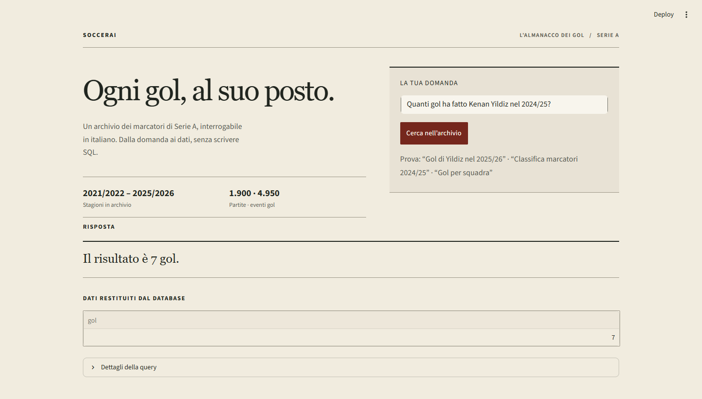

# SoccerAI



## ENG

SoccerAI is a local AI assistant for exploring a Serie A goal archive. Ask football statistics questions in Italian and inspect the SQL and rows behind each answer. It runs Llama 3 locally through Ollama: for open-ended questions, the model translates natural language into read-only SQLite and summarizes the returned data in Italian. No question or database result is sent to a hosted language-model API.

Frequently asked statistics, such as player totals and scorer rankings, use deterministic, parameterized SQL templates to keep those answers predictable. The local model handles questions outside those templates and can also explain tabular results.

### Highlights

- **Auditable answers:** the interface displays the SQL query and database rows behind a response.
- **Local AI inference:** LangChain connects the app to Llama 3 running on your machine with Ollama; prompts and query results stay in this local workflow.
- **Read-only execution:** SQLite denies write operations, and invalid generated queries can be retried using database errors as feedback.
- **Reliable common queries:** templates cover player goal totals, first Serie A goal, scorer rankings, and team totals.
- **Robust player lookup:** normalization handles accents, case, punctuation, and selected transliterations; IDs and aliases resolve names such as “Yildiz”.
- **Data quality checks:** imports compare ESPN match scores against extracted scoring events and map fixtures to OpenFootball rounds before replacing season data.
- **Reproducible local development:** dependencies are locked with `uv`; offline tests use temporary SQLite databases and need neither network access nor Ollama.

### Stack

Python 3.13, Streamlit, SQLite, pandas, SQLAlchemy, LangChain, and Ollama with Llama 3.

### Setup

Install [Python 3.13](https://www.python.org/) and [uv](https://docs.astral.sh/uv/), then run from the project directory:

```powershell
uv sync
uv run python crea-db.py
uv run python importa-marcatori.py
```

The importer downloads the five seasons configured in the project (2021/22 through 2025/26). It uses ESPN's public, undocumented feed for match and goal events and OpenFootball calendars for round numbers. Downloads are cached in `.cache/espn-serie-a`; reruns reuse the cache. Pass `--refresh` to download again. A local backup is created before an existing database is changed. Source validation happens before the database transaction.

The database and downloaded source data are generated locally and excluded from Git. Importing requires internet access. Data availability and third-party feed formats may change; check source terms before redistributing downloaded data.

### Run the app

Install [Ollama](https://ollama.com/), start its local service, and download the model:

```powershell
ollama pull llama3
uv run streamlit run app.py
```

The app opens in your browser. For open-ended questions, LangChain sends the question to your local Llama 3 model, which generates a read-only SQLite query; the SQL results are then used to compose an Italian answer. Common questions use tested SQL templates instead, so key statistics do not depend on model-generated SQL. Inference does not use a cloud AI API and needs no account or API key. Importing football data is a separate step that does require internet access. Template-based queries can still return database results when Ollama is unavailable.

### How the local AI answers a question

1. You enter a question in Italian.
2. SoccerAI matches common statistical requests to a parameterized SQL template. If no template applies, Llama 3 interprets the question and generates a SQLite `SELECT` query.
3. SQLite executes the query in read-only mode, and the app displays the SQL and returned rows for inspection.
4. Simple counts and first-goal results are formatted directly from the data. For other result tables, the local model writes a short Italian summary grounded in those rows.

Example questions:

- `Quanti gol ha fatto Leao nel 2025/26?`
- `Qual è la prima partita in cui ha segnato Yildiz?`
- `Classifica marcatori 2024/25`
- `Gol per squadra nel 2025/26`

### Database and coverage

`calcio.db` is created locally by `crea-db.py` and filled by `importa-marcatori.py`; it is not included in this repository. Seasons are stored in `partite.stagione`. Scorer events link to matches through `marcatori.id_partita`; player IDs and aliases are stored in `giocatori` and `alias_calciatori`. For an existing database with ESPN summaries in cache, `uv run python importa-marcatori.py --players-only` fills player IDs and aliases without network requests.

The app reports the seasons and match counts in the local database. A season is considered complete at 380 matches. ESPN does not document a stable API, so source changes or fixture mismatches can prevent imports. The app does not provide live data.

### Tests

Run the offline test suite:

```powershell
uv run python -m unittest discover -s tests -v
```

Tests cover the SQLite schema and migration, read-only SQL safeguards, query correction, season filtering, name aliases and special characters, first-goal match selection, goal totals, team totals, scorer rankings, and answer formatting. They make no external API calls and do not need a running Ollama service.

Run the curated question-answer regression evaluations:

```powershell
uv run python -m evals.run
```

This evaluates a versioned set of questions against a small synthetic SQLite database, with exact checks for returned rows, query parameters, unknown players, ambiguous names, and season coverage. The report includes pass rates by capability and exits with a non-zero status if a case fails. To include SQL generated by the local model, start Ollama and run `uv run python -m evals.run --include-llm --model llama3`; this optional evaluation may vary with the installed model version and requires no cloud model API. The offline suite remains deterministic and independent of Ollama. Structured database facts are graded exactly; free-form answer wording is tested separately so minor paraphrases do not create brittle failures.

Validation completed with the local `llama3` model: **10/10 evaluation cases passed**, including generated SQL for event counts by type. The full automated test suite also passed: **23/23 tests**. These results use the evaluation suite's synthetic database and are not a guarantee for every question against the full imported archive.

### Project status

SoccerAI is an experimental proof of concept for a portfolio, not a production service. The local database must be imported before the app can display archive coverage. The importer depends on third-party feeds whose formats and availability can change. The project code is released under the MIT License; the license provides the software “as is” without warranty.

---

## ITA

SoccerAI è un assistente con AI locale per esplorare un archivio dei gol della Serie A. Puoi fare domande statistiche in italiano e controllare query SQL e dati alla base delle risposte. L'app esegue Llama 3 sul tuo computer tramite Ollama: per le domande aperte, il modello traduce il linguaggio naturale in query SQLite di sola lettura e riassume i risultati in italiano. Domande e risultati non vengono inviati a un'API di modelli ospitata nel cloud.

Le statistiche richieste più spesso, come i totali dei giocatori e le classifiche marcatori, usano template SQL deterministici e parametrizzati, così da mantenere prevedibili queste risposte. Il modello locale gestisce le domande che non rientrano nei template e può anche spiegare tabelle di risultati.

### Punti di forza

- **Risposte verificabili:** l'interfaccia mostra la query SQL e i dati alla base della risposta.
- **AI eseguita in locale:** LangChain collega l'app a Llama 3 sul tuo computer tramite Ollama; prompt e risultati restano in questo flusso locale.
- **Esecuzione in sola lettura:** SQLite blocca le scritture e le query generate non valide possono essere corrette usando gli errori del database.
- **Domande comuni affidabili:** i template coprono totali per calciatore, prima rete in Serie A, classifiche marcatori e gol per squadra.
- **Ricerca robusta dei giocatori:** la normalizzazione gestisce accenti, maiuscole, punteggiatura e alcune traslitterazioni; ID e alias aiutano a riconoscere nomi come “Yildiz”.
- **Controlli sulla qualità dei dati:** prima di sostituire una stagione, l'importatore confronta i punteggi ESPN con gli eventi gol e abbina le partite ai turni OpenFootball.
- **Sviluppo locale riproducibile:** le dipendenze sono bloccate con `uv`; i test offline usano database SQLite temporanei e non richiedono rete né Ollama.

### Stack

Python 3.13, Streamlit, SQLite, pandas, SQLAlchemy, LangChain e Ollama con Llama 3.

### Installazione

Installa [Python 3.13](https://www.python.org/) e [uv](https://docs.astral.sh/uv/), poi esegui questi comandi dalla cartella del progetto:

```powershell
uv sync
uv run python crea-db.py
uv run python importa-marcatori.py
```

L'importatore scarica le cinque stagioni configurate nel progetto (dal 2021/22 al 2025/26). Usa il feed pubblico non documentato di ESPN per partite ed eventi gol e i calendari OpenFootball per i numeri di giornata. I download sono salvati in `.cache/espn-serie-a` e riutilizzati alle esecuzioni successive. Aggiungi `--refresh` per scaricarli di nuovo. Prima di modificare un database esistente, viene creata una copia locale. I controlli sulle fonti avvengono prima della transazione sul database.

Il database e i dati scaricati sono generati localmente ed esclusi da Git. L'importazione richiede internet. Disponibilità e formato dei feed esterni possono cambiare; verifica le condizioni delle fonti prima di ridistribuire i dati.

### Avvio dell'app

Installa [Ollama](https://ollama.com/), avvia il servizio locale e scarica il modello:

```powershell
ollama pull llama3
uv run streamlit run app.py
```

L'app si apre nel browser. Per le domande aperte, LangChain passa la richiesta al modello Llama 3 locale, che genera una query SQLite di sola lettura; i risultati SQL vengono poi usati per comporre una risposta in italiano. Le domande comuni usano invece template SQL verificati, così le statistiche principali non dipendono da SQL generato dal modello. L'inferenza non usa API AI cloud e non richiede account o chiavi API. L'importazione dei dati calcistici è un passaggio separato che richiede internet. I template possono comunque restituire i dati del database quando Ollama non è disponibile.

### Come risponde l'AI locale

1. Scrivi una domanda in italiano.
2. SoccerAI riconosce le richieste statistiche frequenti e seleziona un template SQL parametrizzato. Se non trova un template adatto, Llama 3 interpreta la domanda e genera una query SQLite `SELECT`.
3. SQLite esegue la query in sola lettura; l'app mostra SQL e righe restituite per permetterti di controllarle.
4. Conteggi semplici e risposte sulla prima rete vengono formattati direttamente dai dati. Per le altre tabelle, il modello locale scrive un breve riepilogo in italiano basato sui risultati.

Esempi:

- `Quanti gol ha fatto Leao nel 2025/26?`
- `Qual è la prima partita in cui ha segnato Yildiz?`
- `Classifica marcatori 2024/25`
- `Gol per squadra nel 2025/26`

### Database e copertura

`calcio.db` viene creato localmente da `crea-db.py` e popolato da `importa-marcatori.py`; non è incluso nel repository. Le stagioni sono salvate in `partite.stagione`. Gli eventi gol si collegano alle partite tramite `marcatori.id_partita`; gli ID e gli alias dei giocatori sono in `giocatori` e `alias_calciatori`. Se esiste già un database con riepiloghi ESPN in cache, `uv run python importa-marcatori.py --players-only` completa ID e alias senza richieste di rete.

L'app mostra stagioni e numero di partite presenti nel database locale. Una stagione è considerata completa con 380 partite. ESPN non documenta un'API stabile: modifiche alla fonte o calendari non corrispondenti possono impedire l'importazione. L'app non fornisce dati in tempo reale.

### Test

Esegui la suite offline:

```powershell
uv run python -m unittest discover -s tests -v
```

I test verificano schema e migrazione SQLite, protezione in sola lettura, correzione delle query, filtri stagione, alias e caratteri speciali, prima partita con gol, totali, classifiche e formattazione delle risposte. Non chiamano API esterne e non richiedono Ollama.

Esegui le valutazioni di regressione sulle domande:

```powershell
uv run python -m evals.run
```

La suite usa un database SQLite sintetico e un insieme versionato di domande; confronta i risultati attesi, i parametri delle query, i giocatori sconosciuti o ambigui e i limiti di copertura delle stagioni. Il report mostra i tassi di superamento per capacità e il comando restituisce un codice di errore se un caso fallisce. Per includere SQL generato dal modello locale, avvia Ollama e usa `uv run python -m evals.run --include-llm --model llama3`: questa valutazione facoltativa può variare in base alla versione del modello installato e non usa API cloud. I test offline restano deterministici e indipendenti da Ollama. I fatti strutturati estratti dal database sono confrontati esattamente; la formulazione libera della risposta è testata separatamente, evitando verifiche fragili basate su frasi identiche.

Verifica completata con il modello locale `llama3`: **10 valutazioni su 10 superate**, incluso il caso di SQL generato per contare gli eventi per tipo. Anche l'intera suite automatica è passata: **23 test su 23**. I risultati si riferiscono al database sintetico della suite e non garantiscono la correttezza di ogni domanda sull'archivio importato completo.

### Stato del progetto

SoccerAI è un proof of concept sperimentale per portfolio e non un servizio destinato alla produzione. Il database locale va importato prima che l'app possa mostrare la copertura dell'archivio. L'importatore dipende da feed di terze parti che possono cambiare formato o diventare indisponibili. Il codice del progetto è distribuito con licenza MIT, che fornisce il software “così com'è” e senza garanzie.
